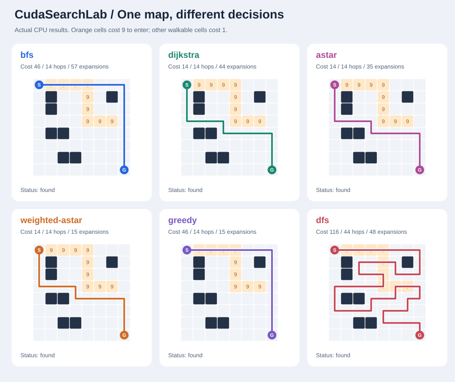

# CudaSearchLab

**Classical graph search in CUDA C++17 — from A* to delta-stepping.**

By [Matin Firoozbakht](https://github.com/matinfirooz).

15 graph-search implementations, a `ucs` alias, CPU references, a command-line
runner, independent shortest-path checks, benchmark tools, and an offline path
explorer. Everything builds without third-party C++ libraries.



The picture uses the checked-in **CPU** results, not GPU measurements. On this
map, orange cells cost 9 to enter. BFS minimizes hops; A* minimizes weighted cost.
Open [the path explorer](docs/path_explorer.html) after downloading the repository
to play each returned route locally.

## What is implemented?

| Family | Commands | CUDA execution |
|---|---|---|
| Breadth-first | `bfs`, `bidirectional-bfs` | Parallel CSR frontier expansion |
| Cost and heuristic | `dijkstra` / `ucs`, `astar`, `weighted-astar`, `greedy` | Device-wide priority scans, then parallel successor relaxation |
| Depth-first | `dfs`, `dls`, `iddfs`, `idastar` | One thread per query, explicit stacks in global memory |
| Bounded and local | `beam`, `hill` | One thread per query |
| Shortest-path relaxation | `bellman-ford`, `delta-stepping` | Parallel label relaxation with stable source snapshots |
| All-pairs shortest paths | `floyd-warshall` | Parallel matrix updates and pivot snapshots |

This is a concrete collection of the main graph-search families. It does not
claim to enumerate every named search algorithm. D*, D* Lite, JPS, MCTS,
adversarial game search, and continuous optimization are outside this release.

## Build and run

Requirements: Linux or WSL2, CMake 3.24+, a C++17 compiler, and an NVIDIA CUDA
toolkit for the GPU backend. Local compile validation used CUDA 13.4; the CI
configuration targets CUDA 12.4. The default GPU target is SM 75.

```bash
cmake -S . -B build -DCMAKE_BUILD_TYPE=Release \
  -DCUDASEARCH_ENABLE_CUDA=ON -DCMAKE_CUDA_ARCHITECTURES=75
cmake --build build -j
ctest --test-dir build --output-on-failure

./build/searchlab --backend cuda --algo astar \
  --grid examples/terrain.txt --validate
```

CPU build, including the correctness tests:

```bash
cmake -S . -B build-cpu -DCUDASEARCH_ENABLE_CUDA=OFF -DCMAKE_BUILD_TYPE=Release
cmake --build build-cpu -j
ctest --test-dir build-cpu --output-on-failure
python3 tools/check_cli.py --exe build-cpu/searchlab
```

The GPU test explicitly skips when no CUDA device is available. A skip does not
establish GPU correctness. See [the recorded validation](docs/VALIDATION.md).

## Try the algorithms

```bash
# All 15 algorithms on a small directed weighted graph.
./build/searchlab --backend cuda --algo all \
  --graph examples/weighted.edgelist --depth 10 --validate

# Weighted A*: priority = g + 2h.
./build/searchlab --backend cuda --algo weighted-astar \
  --grid examples/terrain.txt --weight 2 --validate

# Multiple independent IDA* queries in one GPU kernel.
./build/searchlab --backend cuda --algo idastar \
  --grid examples/maze.txt --queries examples/queries.txt --validate

# Exact bucketed SSSP.
./build/searchlab --backend cuda --algo delta-stepping \
  --random-grid 64 64 --delta 4 --repeat 5 --warmup 1 --validate

# Compare all routes and export them.
./build/searchlab --backend cpu --algo all \
  --grid examples/terrain.txt --depth 64 --beam 8 --validate \
  --json results/my_paths.json --csv results/my_paths.csv
python3 tools/visualize.py --grid examples/terrain.txt --results results/my_paths.json
```

For large graphs, choose one suitable algorithm. Running `--algo all` also runs
exponential depth searches and an O(V³) all-pairs algorithm.

### A useful difference to inspect

These are actual deterministic path/expansion results from `examples/terrain.txt`:

| Algorithm | Weighted path cost | Hops | Vertex expansions |
|---|---:|---:|---:|
| BFS | 46 | 14 | 57 |
| Dijkstra | 14 | 14 | 44 |
| A* | 14 | 14 | 35 |
| Weighted A*, weight 2 | 14 | 14 | 15 |
| Greedy best-first | 46 | 14 | 15 |

The weighted-A* result is specific to this example; it is not a promise of exact
optimality. See [algorithm guarantees](docs/ALGORITHMS.md).

## Data formats

The common domain is a **directed graph with nonnegative uint32 weights**.
Distances use 64-bit integers. Zero weights and zero-weight cycles are supported.
Parallel edges are coalesced to their minimum weight; CSR destinations are
sorted. Bellman–Ford uses the same nonnegative domain in this release.

Graph files start with `V E`, followed by `E` lines of `source destination weight`.
Vertex IDs are zero based. Add both directed edges to represent an undirected edge.
Comments start with `#`.

```text
4 4
0 3 10
0 1 1
1 2 1
2 3 1
```

Grid files use `S`, `G`, `.`, `#`, and digits `1..9`. Digits give the cost of
entering a cell; other walkable cells cost 1. Movement is four-connected. IDs are
`y * width + x`, including isolated wall cells; the CLI rejects wall endpoints.
Queries contain one `source goal` pair per line.

Grid heuristics use Manhattan distance. General graph CLI inputs use `h=0`.
The C++ API accepts custom heuristics; A*, IDA*, and weighted A* check consistency
and require `h(goal)=0`. Exact search with `h=0` is always available.

## C++ API

```cpp
#include "cudasearch/search.hpp"

auto graph = cs::Graph::from_edges(4, {
    {0, 3, 10}, {0, 1, 1}, {1, 2, 1}, {2, 3, 1}
});
cs::Options options;
options.heuristic = {3, 2, 1, 0};
auto result = cs::search_cuda(graph, 0, 3, cs::Algorithm::AStar, options);
// result.path = {0,1,2,3}; result.cost = 3.
```

Link your target against `cudasearch`. The batch API accepts per-query heuristics
for `dfs`, `dls`, `iddfs`, `idastar`, `beam`, and `hill`.

## Correctness and performance

- Independent heap Dijkstra and queue BFS check cost/hop optimality.
- Found paths are checked for valid edges, endpoints, cost, and cycles.
- Tests cover directed graphs, unreachable goals, equal endpoints, zero cycles,
  duplicate edges, 64-bit costs, heuristic consistency, bounded searches,
  randomized graphs, and mixed-goal CUDA batches.
- Race-sensitive relaxations read stable source labels. BFS claims a vertex
  once; parent reconstruction for bulk SSSP traverses tight edges after convergence.
- The A*/Dijkstra kernels are readable baselines with an O(V) priority scan per
  expansion. Small sequential searches can be faster on a CPU.
- Batched DFS-family searches use one thread per query. One query uses one
  thread; a batch exposes parallel work.
- Bidirectional BFS computes two complete distance waves and meets them. It
  currently does not stop the waves early.
- The CPU delta-stepping comparison uses independent heap Dijkstra as its
  reference, rather than a separate CPU bucket implementation.

No GPU speedup or GPU runtime result is claimed in the bundled results.

## Benchmark and inspect

```bash
python3 tools/benchmark.py --exe build/searchlab --backend cuda \
  --sizes 16,32,64 --repeat 5 --warmup 1 --validate --output results/gpu_sweep

compute-sanitizer --tool memcheck --error-exitcode 1 ./build/search_tests --cuda
compute-sanitizer --tool racecheck --error-exitcode 1 ./build/search_tests --cuda
compute-sanitizer --tool initcheck --error-exitcode 1 ./build/search_tests --cuda
```

Timing is median **end-to-end wall time**, including validation of inputs,
allocation, copies, host control, kernels, synchronization, and path
reconstruction. `--validate` runs the independent result oracle outside the
timed region. For a query file, each row repeats the total batch time; do not
sum those repeated times. See [benchmark methodology](docs/BENCHMARKS.md).

## Repository guide

| Path | Contents |
|---|---|
| `src/cuda_search.cu` | CUDA graph-parallel and query-parallel backends |
| `include/cudasearch/batched_core.hpp` | Allocation-free serial search bodies, host/device |
| `src/cpu.cpp` | CPU algorithms and independent shortest-path oracles |
| `src/main.cpp` | CLI, JSON/CSV, warmups, validation |
| `tests/search_tests.cpp` | C++ correctness tests and GPU batch checks |
| `tools/` | Benchmark runner, CLI checks, SVG/HTML route viewer |
| `examples/` | Weighted/directed graphs, mazes, terrain, query file |
| `docs/` | Guarantees, implementation notes, validation, walkthrough |
| `results/` | Measured CPU examples; no GPU measurements |
| `.github/workflows/ci.yml` | CPU tests, sanitizers, CUDA compile check |

## Upload to GitHub

Extract the archive, enter the repository directory, then:

```bash
git init -b main
git add .
git commit -m "Add CudaSearchLab"
gh repo create matinfirooz/CudaSearchLab --public --source=. --remote=origin --push
```

The last command publishes a public repository using your authenticated GitHub
CLI. Alternatively, create the repository in GitHub and upload these source files.

MIT license. [References](docs/REFERENCES.md) · [A* walkthrough](docs/ASTAR.md) ·
[implementation notes](docs/IMPLEMENTATION.md)
